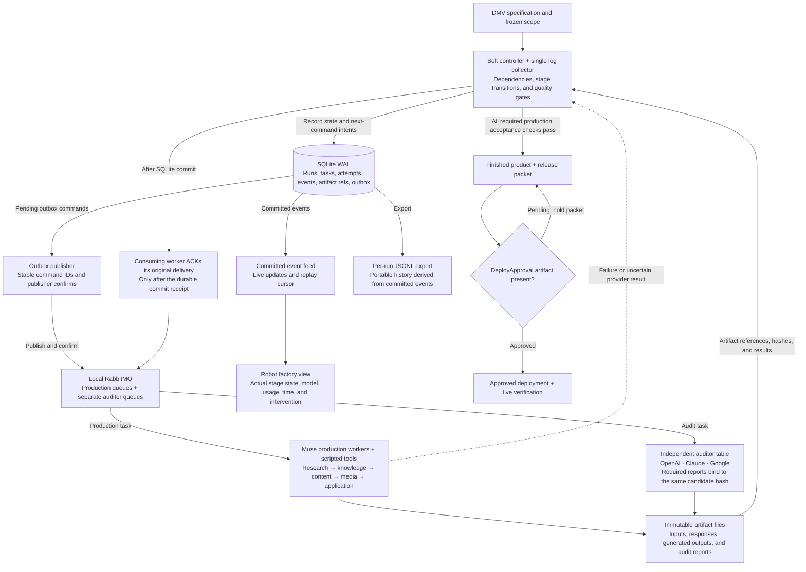
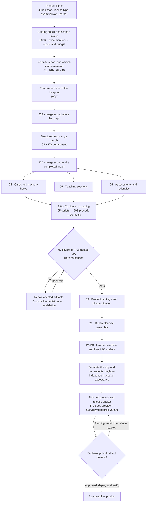
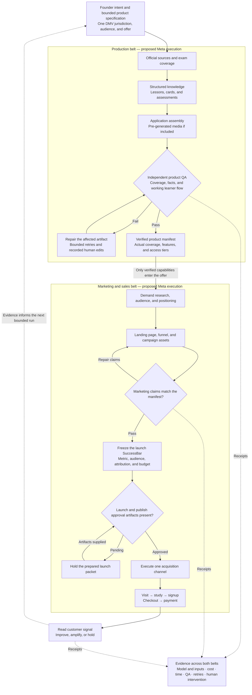

# Nova Meta Hackathon Board

Review revision v0.4.0 supersedes v0.3.0. See [Fable’s original report](reviews/FABLE-CONTRACT-REVIEW.md), [the per-finding disposition](FB-DISPOSITION-v0.4.0.md), [contract](BELT-V2-CONTRACT.md), [review instructions](FABLE-ARGON-REVIEW.md) and [bundle](REVIEW-BUNDLE.json). Claude owns adapter/post-validator delivery through [the monitored handoff](CLAUDE-V0.4.0-SCHEMA-HANDOFF.md); missing owner evidence stays pending.

Locked scope: **regular passenger-car driver's license written-test prep**. State selection stays open; Texas is a candidate only. The pilot profile is sequential controller + SQLite + two independent auditors + free dev preview + static trace. **The animated floor will remain in the contract as deferred work. This is still package preparation only.** No belt, qualification, provider call or service is authorized by this package. The earlier diagrams/concepts below are retained context, subject to the v0.3.0 profile.

## Current working concept

Current focus: the production belt. Its deliverable is a finished, independently checked product and release packet. Marketing and sales follow after this first belt; they remain reference context below.

Use Meta models to execute a bounded path through Nova's production belt and marketing and sales belt. The proposed output is one DMV preparation product and a functioning customer-acquisition funnel. The state, license type, acquisition channel, implementation scope, and code-reuse conditions remain to be settled. This diagram describes the proposed execution; it does not report a completed run.

The reconstructed submitted application remains the Nova V2 knowledge-decompression experiment described in `INSTRUCTIONS.md`. This board captures the later working concept for discussion.

## Production belt with handoffs and logging

RabbitMQ is selected for local worker handoffs. SQLite in WAL mode is selected for the run ledger, indexed metrics, and pending-message outbox. Immutable artifact files remain the evidence for the actual outputs. These are design decisions for the proposed implementation; this board update installs and runs none of these components.

The controller chooses eligible work. RabbitMQ transports stage assignments and auditor jobs. The factory view reads committed ledger events and never consumes worker jobs. The production stations below define the dependencies inside the worker group; they are not one unbounded model assignment.

| Component | Responsibility |
|---|---|
| RabbitMQ | Durable work queues and persistent messages, manual consumer acknowledgements, publisher confirms, bounded retries, and quarantined failures. Messages carry small identifiers and artifact references. |
| Controller and collector | One authority for workflow transitions and one serialized writer to the local ledger. Workers wait for its durable commit receipt before acknowledging deliveries. |
| SQLite WAL ledger | Indexed run/task state, append-only events, individual model-call attempts and usage, artifact references, and a transactional outbox. The collector uses `synchronous=FULL`; a receipt requires its durable commit. |
| Artifact files | Prompts, responses, source snapshots, generated products, audit reports, and detailed error records. Store once and reference by path and hash. |
| JSONL export | A derived, ordered per-run history for inspection and replay. It is not a second independently written source of event truth. |
| Factory view | Live progress and clearly labelled replay from the same committed history. Provider shirts identify actual recorded calls; scripted operations appear as machines. |

### Completion and recovery

1. Record the task attempt before making the provider request.
2. Flush completed output to a temporary file and publish it through atomic rename with the platform-supported persistence operations, then calculate its hash. Atomic rename alone is not a durability guarantee.
3. With the collector configured for WAL and `synchronous=FULL`, record the artifact reference, attempt outcome, workflow event, and controller-approved next-command outbox entry in one transaction. Wait for the commit to complete durably.
4. Return the durable commit receipt to the consuming worker; that consumer acknowledges the original delivery on its own channel.
5. Publish pending outbox commands with confirms. Stable IDs and idempotent consumers handle a crash between publish and marking an outbox entry sent.

Artifact files and SQLite do not share a transaction. Startup recovery reconciles unreferenced files and missing or hash-mismatched referenced files without treating file presence as acceptance. A timeout after a provider accepts a request can leave an `unknown_provider_result`; unavailable usage and cost stay unknown rather than becoming zero. Retry policy must account for that ambiguity.

Model completion, artifact persistence, validation, and stage acceptance are distinct events. Audit completion advances the workflow only when the required checks and reports apply to the same candidate revision. A changed candidate must receive the required checks again.

### Metrics and factory states

Capture run, stage, task, attempt, event, causation, and provider-request identifiers; worker role; actual provider and model; input/output hashes; artifact references; queue wait and execution duration; provider-reported token usage; estimated cost with pricing provenance; validation/audit results; retries; and human decisions or edits.

Persist lifecycle transitions and completed-call usage rather than every streamed token. Use a collector-assigned event sequence for replay. Keep large bodies in artifacts, exclude credentials, and sanitize any public export. The factory's display states are queued, working, output saved, awaiting inspection, accepted, repair, and blocked; they are projections of recorded events, not simulated completion.

References: [RabbitMQ reliability](https://www.rabbitmq.com/docs/reliability), [acknowledgements and confirms](https://www.rabbitmq.com/docs/confirms), and [SQLite WAL](https://sqlite.org/wal.html).

## Production stations and acceptance

Meta is the proposed executor of the authoring and assembly work. Deterministic checks and independent source-grounded review retain their own acceptance authority. The 08 source-tier check runs first; a legally required clinical/legal review blocks on its returned ExternalReviewArtifact. Publication follows its reserved approval gate; no deployment is authorized by drawing this map.

Every stage retains inputs, outputs, source references, model provenance, cost, time, retries, and human edits. Continuous controls include the executor lock, contract freeze, schema validation, source provenance, dynamic-fact separation, and bounded route-back. Card narration consumes the accepted 04 card backs before 05 scripts, 20B prosody, and 20 audio. The existing teacher_soul gate is citizenship-scoped; this proposed DMV map does not claim its rollout.

## Two belt reference

The manifest connects production to marketing. Customer response is a measured outcome, with purchases reported only when they occur. QA failure repairs the affected artifact; it does not silently lower the acceptance bar. Approval gates consume artifacts asynchronously.

## Judging rubric supplied by the founder

| Category | Weight | Description |
|---|---:|---|
| Impact | 30% | What's the real-world potential here? Who benefits, and how much does it matter? Could this actually become something people use? Does it fit into one of the problem statements listed above? |
| Use of Meta AI Tooling | 25% | How creatively did this team use Meta's AI tooling? Did they go beyond a basic integration? Did they surface capabilities that surprised even us? |
| Technical Depth & Execution | 20% | Is the engineering sound and thoughtfully refined? Does this feel like something that was thought through with real craft. |
| Demo | 25% | Is this a working, impressive demo? Does the product hold up live? Is the demo video genuinely cool to watch? |

The descriptions above preserve the founder-supplied text. They are judging criteria, not scores earned by this proposed entry.
